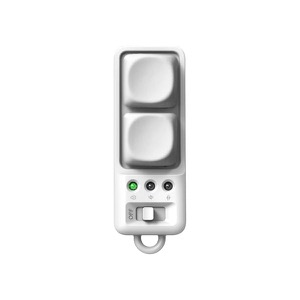
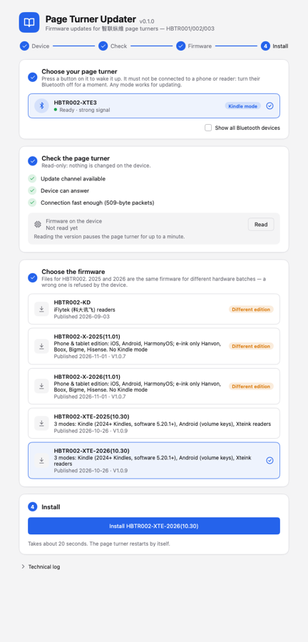
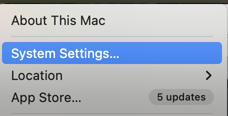
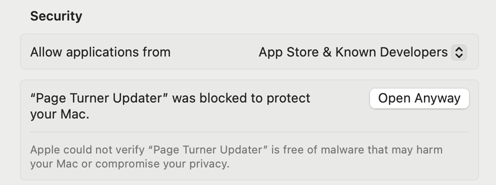
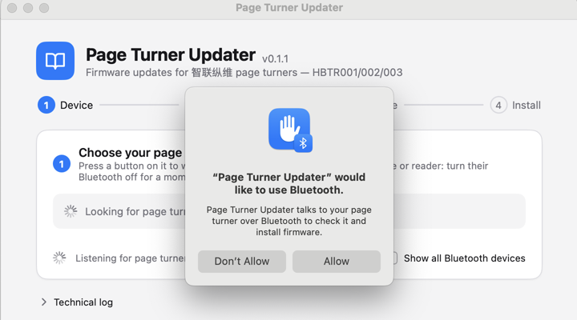

# Page Turner Updater for Mac

A free Mac app that updates the firmware of **智联纵维 (Zhilian Zongwei)** Bluetooth page turners
(HBTR001 / HBTR002 / HBTR003) **without the WeChat mini-program**.

**Why you might need this:** Kindles from 2024 or later and the Kindle Scribe (2022), on Kindle software **5.20.1 or newer**, now accept
Bluetooth page turners. Many of these remotes ship with Kobo, Xteink or phone firmware and need a firmware update
before they work with a Kindle. The maker offers that update in a WeChat mini-program; this app does the same
update from a Mac, in English.

**[⬇ Download for Mac](https://github.com/patricksuo/ebook-remote-firmware-updater/releases/latest)** · macOS 12 or later · Apple Silicon and Intel

No Mac? For these 智联纵维 HBTR remotes, use the maker's official WeChat mini-program on your phone: **[step-by-step guide with screenshots](docs/WECHAT.md)**.

> Use at your own risk: a firmware update can leave a remote unable to do what it did before.
> This app is unofficial; see [Disclosure](#disclosure).

## Disclosure

- I'm not affiliated with the maker, but I'm not neutral either: I run a Shopify store ([hqb.market](https://hqb.market/?utm_source=github&utm_medium=referral&utm_campaign=page-turner-updater))
  that sells their HBTR page turners, and I buy from them directly. I have no connection with the Amazon stores selling these remotes.
- I mostly test firmware switching on an HBTR002-XTE. I plan to test the HBTR001-K and the HBTR003-X next.
  If you have one of these and want to try before I do, you're welcome to, at your own risk, and please share the result.
- I'd like to add support for Hanlinyue (翰林阅) page turners too. Until then, they can be updated with a phone app
  from their chip maker: [Hanlinyue's official guide](docs/HANLINYUE.md) (translated; I don't own one, so it's unverified).

## Which remote do I have?

The maker makes three bodies. It names them only HBTR001, HBTR002 and HBTR003, and Amazon listings call them
different things; in my store they're **Mini**, **Ergo** and **Keycap**. Each body comes in several **editions**:
same shell, different firmware or chip batch. The edition is in the Amazon listing or on the box.

|  |  |  |
|:---:|:---:|:---:|
| **HBTR001 · Mini** | **HBTR002 · Ergo** | **HBTR003 · Keycap** |
| two round buttons | three round buttons, mode switch on the side | two mechanical keys, three LEDs, slide switch |

## Will it work with my Kindle?

**If your remote already pairs with your Kindle and turns pages, you don't need this app.**

Status: ✅ **Verified**: tested by me, or the maker's own Kindle edition · 🟢 **Reported**: the maker or other users say it works, not yet tested by me ·
❌ **No**

Availability is as of November 2026.

### HBTR001 · Mini

| Edition | On Amazon? | With a Kindle | Status | How I know |
|---|---|---|---|---|
| E (Kindle) | Coming soon (per the maker) | Works out of the box | ✅ Verified | Sold by the maker as the Kindle edition |
| K (Kobo) | Yes | After updating to `HBTR001-E` | 🟢 Reported | Reddit users did it with the official WeChat mini-program ([example](https://www.reddit.com/r/kindle/comments/1xl9tiz/comment/19rzosvw6l1l0/)); the maker confirms K → E. Not yet tested with this app |
| Phone edition (no suffix), shows up as `HBTR001` | Unknown | After updating to `HBTR001-E` | 🟢 Reported | The maker confirms HBTR001 → E. Not yet tested with this app. Its original firmware (`HBTR001-2025/2026`) is still in the maker's list, so you can go back |
| Xteink: Amazon "Bluetooth Page Turner Clicker for XTEINK X4 E-Book Reader", shows up as `XT01` | Yes | — | ❌ No | The maker says no: it's Xteink-only hardware. The Amazon listing itself says to pair with "XT01". [A Reddit user](https://www.reddit.com/r/kindle/comments/1xam01u/comment/19s0igvdvu2de/) found no firmware for it in the official mini-program |

### HBTR002 · Ergo

| Edition | On Amazon? | With a Kindle | Status | How I know |
|---|---|---|---|---|
| E (Kindle) | Coming soon (per the maker) | Works out of the box | ✅ Verified | The maker's announcement; not out yet |
| XTE (3 modes) | No (sold in China only, AFAIK) | Works out of the box | ✅ Verified | Pairs with a Kindle; I've also switched it to other firmware and back with this app |
| XT (older Xteink edition) | No | After updating to `HBTR002-XTE` | 🟢 Reported | The maker's reply to an HBTR002-XT owner: install 002-XTE in the mini-program |

### HBTR003 · Keycap

| Edition | On Amazon? | With a Kindle | Status | How I know |
|---|---|---|---|---|
| E (Kindle) | Coming soon (per the maker) | Works out of the box | ✅ Verified | The maker's announcement; not out yet |
| XTE (3 modes) | No (sold in China only, AFAIK) | Works out of the box | ✅ Verified | Pairs with a Kindle out of the box |
| X (phone & tablet / "TikTok") | Yes | After updating to `HBTR003-XTE` (one-way) | 🟢 Reported | The maker confirms the HBTR003 on Amazon (sold as a TikTok scrolling remote / page turner) is the HBTR003-X sold in China, which can be updated to HBTR003-XTE. Not yet tested with this app. **There's no HBTR003-X firmware to go back to: you lose the phone swipe modes for good.** |

**Which Kindles work:** Kindle (2024), Kindle Paperwhite (12th gen), Kindle Colorsoft, Kindle Scribe (2024), the 2026
Kindles, and the Kindle Scribe (2022), with Kindle software 5.20.1.0.2 or later. As far as I know, older Kindles don't
support Bluetooth page turners yet. To find your model, open *Settings › Device Options › Device Info* on the Kindle.
Jailbroken Kindles on older software need Bluetooth/key-mapping plugins instead.

In firmware names, `(10.30)` is the maker's build label (it looks like a date), not a version number.

### After the update

- **HBTR001-E is Kindle-only.** It stops working with other readers. You can usually go back by installing `HBTR001-K`,
  as long as the maker keeps that file in its list.
- **HBTR002/HBTR003-XTE** has 3 modes on the slide switch: **position marked up/down (↕) = Kindle**, left/right (↔) = Xteink,
  volume = Android readers (volume-key page turning).
- **iPhone/iPad and TikTok-style swiping**: the XTE firmware has no touch-swipe mode. The phone edition (`HBTR002-X`)
  swipes (up/down for short videos, left/right for reading); per the maker's manual, iOS needs
  *Settings › Accessibility › Zoom* turned on for that.

## How to use

(On a phone instead: [WeChat mini-program guide for HBTR remotes](docs/WECHAT.md).)

<details>
<summary>What the app looks like</summary>



</details>

1. **Install the app.** Open the .dmg and drag **Page Turner Updater** into *Applications*. The app isn't signed with
   an Apple developer certificate, so macOS blocks the first launch:
   1. Open the app. macOS says *"Page Turner Updater" Not Opened*: click **Done** (not *Move to Trash*).
   2. Apple menu › **System Settings…** › **Privacy & Security** (or type `security` in the search box). Scroll down
      to *Security* and click **Open Anyway**, then confirm if macOS asks.
   3. Open the app again and click **Allow** when it asks to use Bluetooth.

   (On macOS 14 and earlier you can also right-click the app and choose *Open*.)

   <details>
   <summary>Screenshots</summary>

   | | | | |
   |:---:|:---:|:---:|:---:|
   |  |  |  |  |
   | Click **Done** | **System Settings…** | **Open Anyway** | **Allow** |

   </details>
2. **Get the remote ready.** Switch it on, with enough battery. If it's paired to a phone, Kindle or Mac, **forget it there
   first**: it only shows up while it isn't connected to anything.
3. **Choose your remote** in the app. *Check* is read-only.
4. **Choose the firmware** from the tables above. Most files come in a `-2025` and a `-2026` version: the same program
   for two production batches of the chip, and you can't tell the batch from the outside.
   **Try 2026 first; if the update stops right away with "key mismatch", install 2025.**
5. **Click Install.** It takes about 20 seconds; keep the remote next to the Mac and don't press its buttons.
   The remote restarts by itself. If macOS asks whether to connect the remote, either answer works for the update.
6. **Pair it with your Kindle:** forget the remote in the Mac's Bluetooth settings, put an XTE remote in the ↕ position,
   then on the Kindle go to *Settings › Bluetooth*.

## Troubleshooting

- **The app doesn't find the remote.** Press a button to wake it. Make sure it isn't connected to a phone or Kindle
  (turn their Bluetooth off for a moment). Check that the app is allowed in *System Settings › Privacy & Security › Bluetooth*.
- **"key mismatch".** The file is for the other chip batch. Nothing was installed; choose the other year (2025 ↔ 2026).
  If both are refused, your remote is a different edition than you think: check the tables above.
- **The update stopped halfway** (timeout, disconnected). Turn the remote off and on, then install again. It
  continues where it stopped.
- **"Wait … s" after reading the version.** Reading the installed version puts the remote in update mode for up to
  a minute. Wait, or turn it off and on.
- **The Kindle doesn't find the remote after the update.** Check the Kindle's model and software (see *Which Kindles work* above), the
  switch position (↕ on XTE remotes), and that the remote isn't still connected to the Mac.

## Where the firmware comes from

The app doesn't include any firmware. When you click Install, it downloads the file from the maker's own server, the same
list the WeChat mini-program uses, so you always get the maker's current files. Before installing, it checks that
the file is complete and refuses it if not. It also compares the file with the copy I checked (SHA-256): a difference
is written to the Technical log, not blocked, because it usually means the maker has updated the file.
The remote itself checks each file's batch key and CRC.
All files, with dates, sizes and SHA-256: [docs/FIRMWARE.md](docs/FIRMWARE.md).

## Build from source

With Go 1.27+:

```sh
go tool mygo build -platform darwin/universal   # → build/darwin-universal/Page Turner Updater.app + .dmg
```

Development:

```sh
go tool mygo dev     # run with live reload
go test ./...        # protocol tests (simulated device) + headless UI tests
go build -o bin/blecheck ./cmd/blecheck && bin/blecheck HBTR   # read-only Bluetooth check from the terminal
```

No cgo: [MyGo](https://github.com/egoist/mygo) native UI, CoreBluetooth through
[purego](https://github.com/ebitengine/purego)'s Objective-C runtime.

| Package | What |
|---|---|
| `zl` | protocol: firmware list, firmware/hardware matching, frame builder, update state machine |
| `ble` | CoreBluetooth central (scan, connect, notify, flow-controlled writes) |
| `main.go`, `view.go` | the UI: choose device → check → choose firmware → install |

How the update protocol works: [docs/PROTOCOL.md](docs/PROTOCOL.md).
The app's version is shown next to its name; releases are on the [Releases](https://github.com/patricksuo/ebook-remote-firmware-updater/releases) page.

## License

The app's code is under the [MIT License](LICENSE). The firmware files belong to the maker; they aren't part of this
repository and are downloaded from the maker's server when you install them.

## Help me fill in the tables

If you update a remote marked 🟢 Reported, please open an issue with:
- the Bluetooth name before and after,
- which file you installed (2025 or 2026) and whether it worked,
- where you bought it (an Amazon link helps).
