# Updating a 智联纵维 (Zhilian Zongwei) HBTR remote with the official WeChat mini-program (iPhone / Android)

**This guide is only for 智联纵维's HBTR series: HBTR001 (Mini), HBTR002 (Ergo) and HBTR003 (Keycap).** Other makers'
remotes use other updaters; for Hanlinyue (翰林阅) see [HANLINYUE.md](HANLINYUE.md).

No Mac? You can do the same update with the maker's own updater: the **智联纵维** mini-program
inside the WeChat app. It installs the same firmware files from the same server as the Mac app; only the route differs.

What you need: a phone with WeChat, your remote (turned on, battery not low), about 10 minutes the first time.
The screenshots below are from an iPhone in English, updating an HBTR002 (Ergo) to `HBTR002-XTE-2026`. Your remote's
firmware list will show its own files (`HBTR001-…` for a Mini, `HBTR003-…` for a Keycap).

**First check which firmware you need:** [Which file?](#which-file) (details in the README:
[Will it work with my Kindle?](../README.md#will-it-work-with-my-kindle)).

## 1. Get a WeChat account

Skip this if you already use WeChat.

<table>
<tr>
<td width="33%" align="center"></td>
<td width="33%" align="center">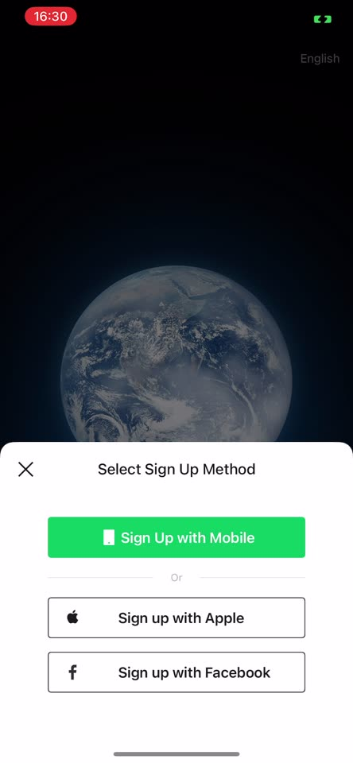</td>
<td width="33%" align="center">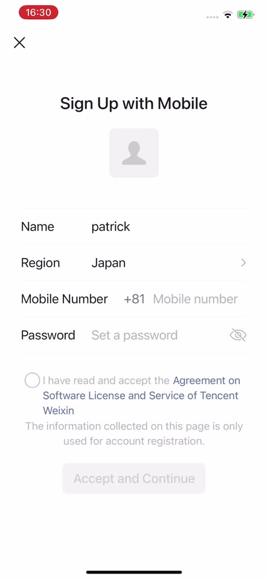</td>
</tr>
<tr valign="top">
<td>Install WeChat from the App Store or Google Play, tap <b>Sign Up</b></td>
<td>Pick any method. Even with <b>Sign up with Apple</b>, WeChat still asks for a phone number next</td>
<td>Set <b>Region</b> to your country first (it starts on <i>China's Mainland</i>), then your mobile number and a password. Tick the agreement, <b>Accept and Continue</b></td>
</tr>
</table>

WeChat then texts you a verification code. If you get stuck, use the [Mac app](../README.md) instead.

## 2. Open the 智联纵维 mini-program

<table>
<tr>
<td width="50%" align="center">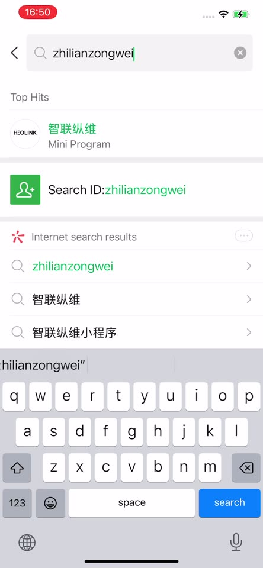</td>
<td width="50%" align="center">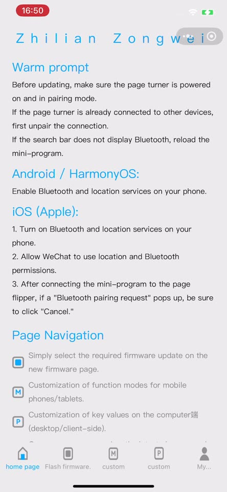</td>
</tr>
<tr valign="top">
<td>In WeChat, tap the <b>search</b> icon and type <code>zhilianzongwei</code> (or <code>智联纵维</code>). Tap the top hit named <b>智联纵维</b> and marked <b>Mini Program</b></td>
<td>The mini-program is in Chinese. WeChat can translate it: see below. Translated, the home page lists the same steps as this guide</td>
</tr>
</table>

### Show it in English (or your language)

<table>
<tr>
<td width="50%" align="center">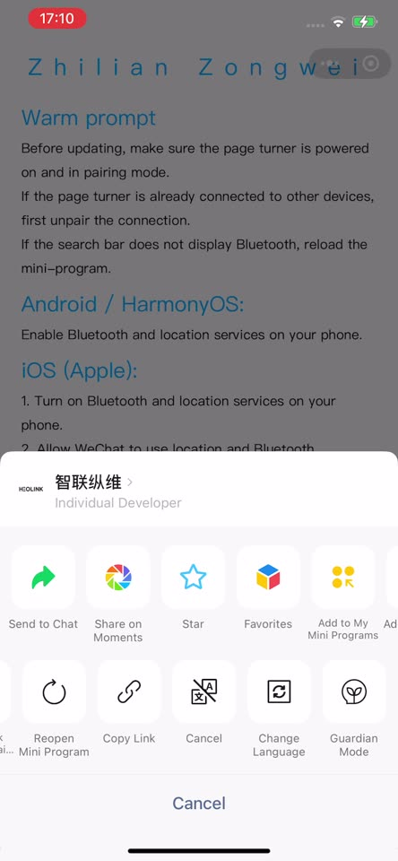</td>
<td width="50%" align="center">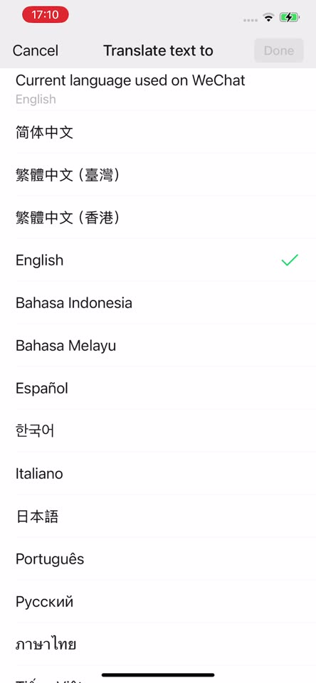</td>
</tr>
<tr valign="top">
<td>Tap <b>•••</b> at the top right of the mini-program. In the second row of the menu, swipe left and tap <b>Change Language</b></td>
<td>Pick your language (English, Español, 日本語, …) and tap <b>Done</b>. The page reloads translated</td>
</tr>
</table>

It's a machine translation, so a few labels come out odd; they're explained in the steps below.

## 3. Connect the remote

Before you start:
- Turn on **Bluetooth and Location** on the phone, and allow WeChat to use both when it asks.
- **Forget the remote** wherever it's paired (Kindle, phone, Mac) and turn it off and on: it only shows up while
  it isn't connected to anything. According to the maker, the LED blinks when it's ready and doesn't blink while it's
  connected to something (I haven't checked this myself).

<table>
<tr>
<td width="25%" align="center">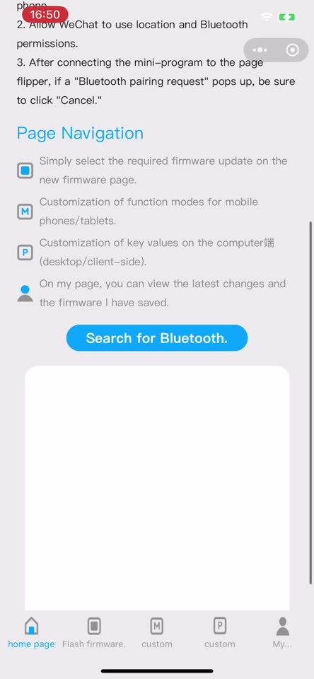</td>
<td width="25%" align="center">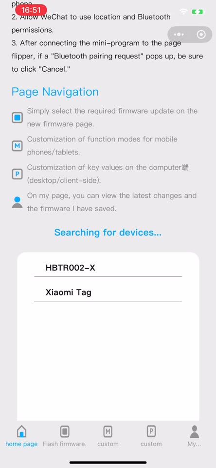</td>
<td width="25%" align="center">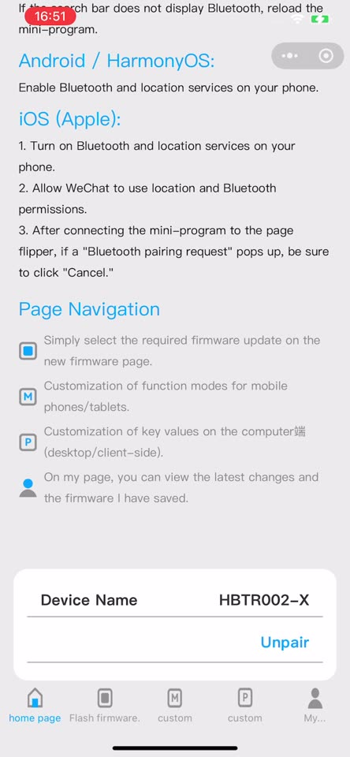</td>
<td width="25%" align="center">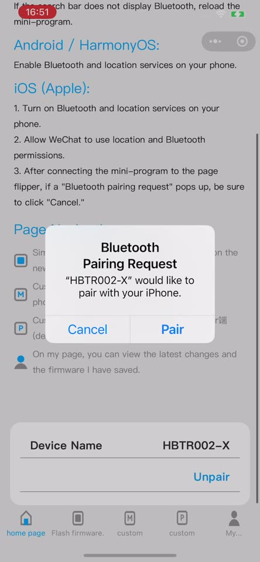</td>
</tr>
<tr valign="top">
<td>On the <b>home page</b> tab, scroll down and tap <b>Search for Bluetooth.</b></td>
<td>Tap your remote (<code>HBTR001…</code>, <code>HBTR002…</code> or <code>HBTR003…</code>)</td>
<td>Connected: it shows <i>Device Name</i> and <i>Unpair</i></td>
<td>iPhone: if a <b>Bluetooth Pairing Request</b> pops up, the maker says to tap <b>Cancel</b></td>
</tr>
</table>

**Remote not in the list?** It's probably still connected to your Kindle or another device: disconnect it there
first (or turn that device's Bluetooth off), turn the remote off and on, and search again. An HBTR002 with XTE
firmware shows a different name for each switch position (`HBTR002-XTE3`, `HBTR002-XT`, `HBTR002-XTE`).

## 4. Install the firmware

### Which file?

| Your remote | Tap | Note |
|---|---|---|
| HBTR001-K (Kobo) | `HBTR001-E-2026(10.30)` | |
| HBTR001 (phone edition, no suffix) | `HBTR001-E-2026(10.30)` | |
| HBTR002-XT | `HBTR002-XTE-2026(10.30)` | |
| HBTR003-X | `HBTR003-XTE-2026(10.30)` | One-way: there's no HBTR003-X file to go back to |
| Any E or XTE edition | Nothing | It already works with a Kindle |
| XT01 (Xteink) | Nothing | Can't be updated |

If the 2026 file is refused, use the 2025 one (see [2025 or 2026?](#2025-or-2026)). Leave the other files alone.

<table>
<tr>
<td width="33%" align="center">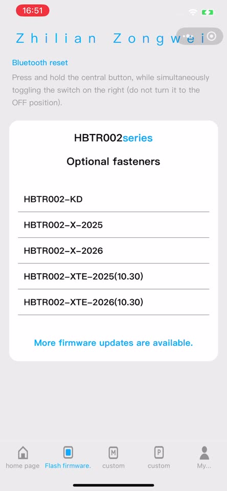</td>
<td width="33%" align="center">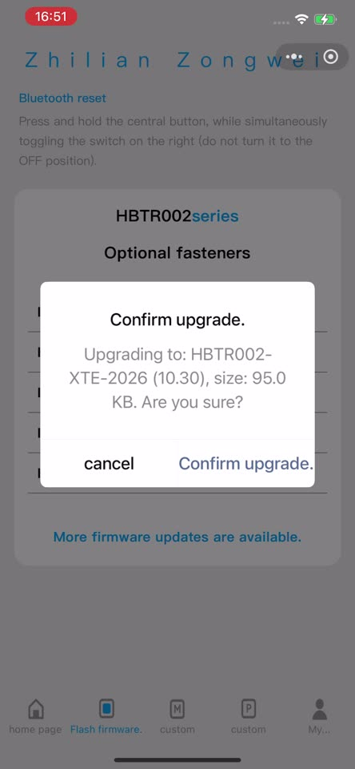</td>
<td width="33%" align="center">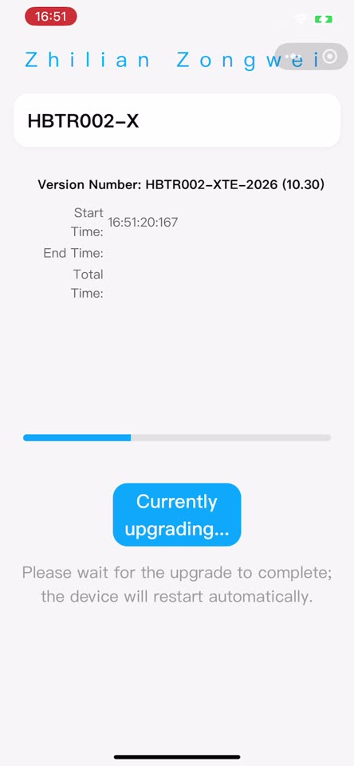</td>
</tr>
<tr valign="top">
<td>Open the <b>Flash firmware</b> tab at the bottom. It lists the files for your remote (the translation says <i>Optional fasteners</i>; it means <i>available firmware</i>). Tap the one you need</td>
<td>Check the name, then <b>Confirm upgrade</b></td>
<td>Keep the phone next to the remote and don't press its buttons. <b>Don't leave the mini-program or switch pages until it's done.</b> It took about 35 seconds here</td>
</tr>
</table>

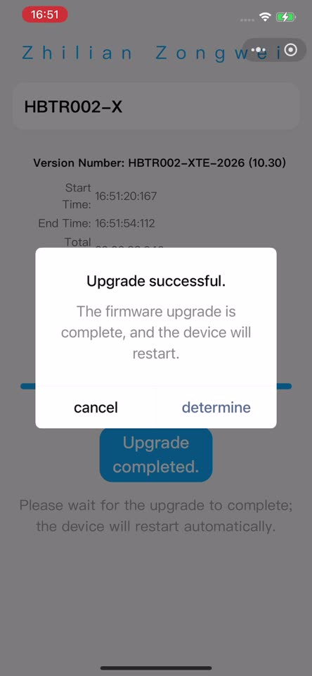

**Upgrade successful**: the remote restarts by itself (the maker says its LED starts blinking again).
Tap OK (the translation says *determine*).
To be safe, then turn the remote **off and on** once yourself.

### 2025 or 2026?

Most files come in a `-2025` and a `-2026` version for two production batches of the chip; you can't tell them apart
from the outside. **Try 2026 first.** If the update stops right away with a *KEY mismatch* error
(文件包返回错误，KEY不匹配), nothing was installed: install the 2025 file instead. If both are refused, your remote is
a different edition than you think; check the README tables.

## 5. Pair it with your Kindle

1. **Disconnect the remote from your phone**, or the phone may grab it again before the Kindle can:
   in the mini-program tap **Unpair** and close WeChat. If the remote also shows up in the phone's own Bluetooth
   settings, tap it there and choose **Forget This Device** (iPhone) or **Unpair** (Android). Turning the phone's
   Bluetooth off while you pair the Kindle works too.
2. **HBTR002 / HBTR003 (XTE firmware):** set the slide switch to the **up/down (↕)** position. That's Kindle mode.
3. On the Kindle: *Settings › Bluetooth*, then pair the remote.

The Kindle needs software **5.20.1.0.2 or later** and a supported model; see
[Which Kindles work](../README.md#will-it-work-with-my-kindle).

## If something goes wrong

- **The remote isn't in the list.** The maker says: if it's connected to another device, disconnect it there first;
  if the search area doesn't show Bluetooth, reload the mini-program.
- **Bluetooth reset.** The maker's tips: HBTR001: hold the small button for 5 seconds (from the firmware file names).
  HBTR002: hold the center button while moving the side switch (but not to OFF) (from the Flash firmware page).
- **The Kindle doesn't find the remote.** Check the Kindle's model and software (HBTR002/HBTR003: switch on ↕), and that the
  remote isn't still connected to the phone.

Questions, or a remote that isn't in the README tables yet? [Open an issue](https://github.com/patricksuo/ebook-remote-firmware-updater/issues).
